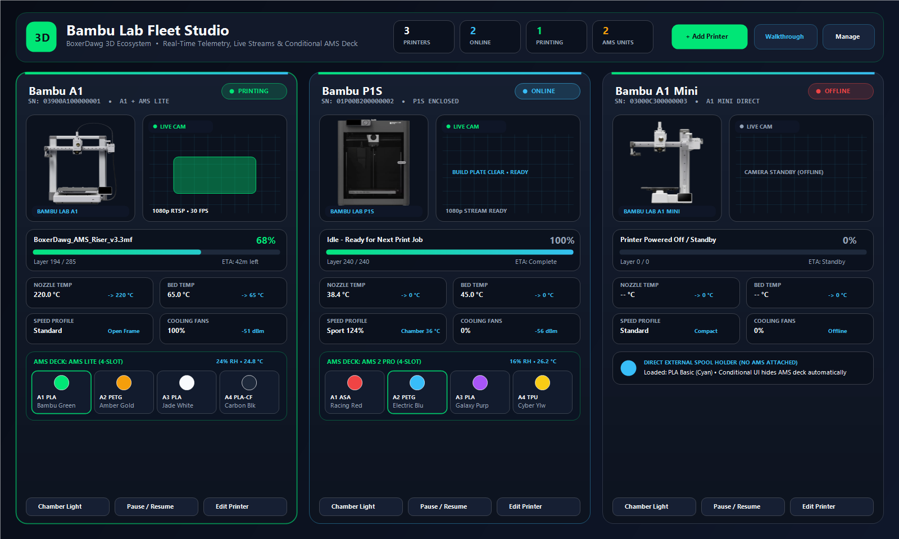
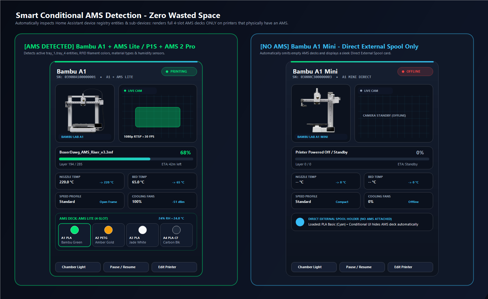
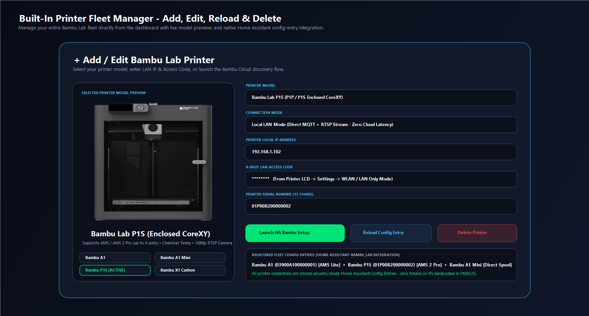
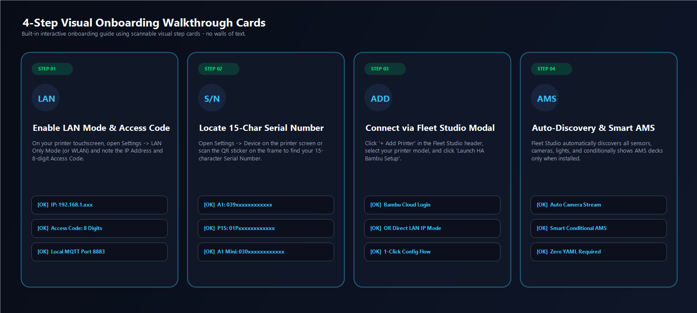
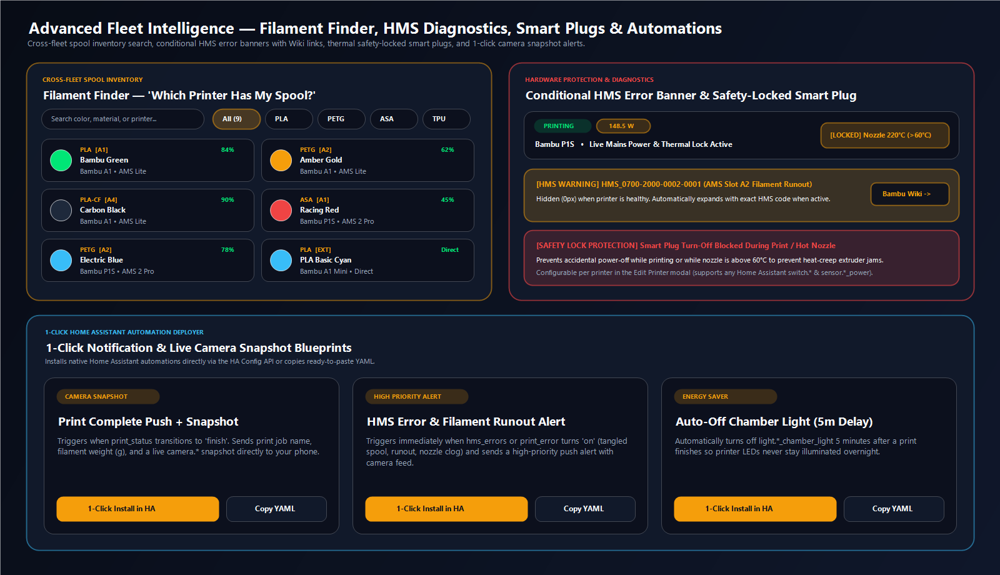

# 🖨️ Bambu Lab Fleet Studio `[v1.4.0]` — Home Assistant Dashboard & Custom Cards

[-00e676?style=flat-square&logo=github)](https://github.com/everyday3d/bambu-fleet-studio/releases/latest)
[](https://github.com/hacs/default)
[](https://github.com/everyday3d/bambu-fleet-studio/issues)
[](LICENSE)

> [!NOTE]
> **👋 Hello makers!** This is a project I've been working on for some time, and I think I'm finally ready to release it to the community.
>
> Having every Bambu Lab printer in my shop on a single, clean Home Assistant screen has been a total game-changer—being able to glance at live camera feeds, check nozzle/bed temps, see exact layer progress & ETAs, and immediately spot which filament colors and materials are loaded in each AMS without bouncing between Bambu Handy or Bambu Studio is ridiculously handy. It even knows which printers actually have an AMS attached (so your non-AMS printers stay clutter-free) and lets you add or manage printers right from the dashboard.
>
> Since this is a fresh release, **expect some bugs!** If you run into anything quirky or have an idea that would make your print room easier to run, please drop a ticket in the **[Issue Tracker](https://github.com/everyday3d/bambu-fleet-studio/issues)** and I will get it fixed! I hope you enjoy using it in your workshop as much as I do.

> A professional, card-based Home Assistant Lovelace dashboard and zero-dependency Web Component suite (`bambu-fleet-cards.js`) purpose-built for managing multi-printer **Bambu Lab** 3D printing, laser & AMS fleets (**`A1`**, **`A1 Mini`**, **`A2L`**, **`P1P`**, **`P1S`**, **`P2S`**, **`X1C`**, **`X1E`**, **`X2D`**, **`H2C`**, **`H2D`**, **`H2D Pro`**, **`H2S`**, the **`R1` 55W CO2 Laser Cutter & Engraver**, plus **`AMS`**, **`AMS Lite`**, **`AMS 2 Pro`**, and **`AMS HT`**).

---

## 🆕 What's New in `v1.4.0`

- **🔧 Bambu Lab H2C Vortek 7-Nozzle Changer (`1L + 6R`) & H2D / H2D Pro / X2D Dual-Nozzle Telemetry & Card UI (`#41` — *`H2C` & `X2D` untested on physical hardware; community feedback needed!*)**:
  - **Dual-Nozzle Telemetry Tile (`L + R`)**: Displays simultaneous **Left (`L`)** and **Right (`R`)** nozzle temperatures, active nozzle highlighting, and per-nozzle targets & diameters (`L→220°C (0.4mm) • R→250°C (0.4mm)`), plus dual-nozzle Smart Plug thermal safety lock (`max(L, R) > 60°C`).
  - **Dedicated `.vortek-deck` (`🔧 Bambu Vortek 7-Nozzle Changer`) for `H2C`**: Displays the **1 Fixed Left Hotend (`L • FIXED`)** alongside all **6 Swappable Right Induction Hotends (`R1`–`R6`, ~8s swap)** decoded from Local LAN MQTT (`device.extruder` & `device.nozzle`) with live **`MOUNTED`**, **`DOCKED`**, and **`EMPTY`** status badges, nozzle diameters (`0.2mm`–`0.8mm`), flow ratings (`Standard` / `High-Flow` / `TPU High-Flow`), materials (`Hardened Steel` / `Stainless Steel` / `Tungsten Carbide`), and accumulated print hours.
  - **🧪 Call for `H2C` & `X2D` Community Testing**: Because we do not have physical `H2C` or `X2D` hardware in our shop yet, `H2C` Vortek 7-nozzle changer and `X2D` dual-nozzle support are marked **`🧪 Beta • Community Feedback Needed`**. If you run an `H2C` or `X2D`, please let us know in **[GitHub Issues](https://github.com/everyday3d/bambu-fleet-studio/issues)** or **[Discussions](https://github.com/everyday3d/bambu-fleet-studio/discussions)** how it works on your machine!
- **🎉 Official HACS Default Store Inclusion & Security Hardening (`hacs/default#11882`, `#38`, `#39`, `#40`)**:
  - **Merged into the Official HACS Default Store**! Includes HMAC-signed camera snapshot/stream URLs (`async_sign_path` with signed `_ts` cache-busting), universal `escapeHtml()` XSS protection across all card views, administrator RBAC enforcement on mutating endpoints, and Home Assistant Issue Registry (`bad_access_code`) repair alerts with exponential MQTT backoff.

---

## 🌟 Why Bambu Lab Fleet Studio?

Default Home Assistant entity lists clutter your screen with dozens of ungrouped sensors and render empty AMS filament slots even on printers that do not have an AMS attached. **Bambu Lab Fleet Studio** replaces walls of text and scattered entities with a sleek, dark-glass industrial command center:

- **🔌 100% Standalone Local LAN Engine (`Zero External Dependencies`)**: Includes its own built-in Home Assistant backend (`custom_components/bambu_fleet_studio/`) that connects **directly** to your Bambu Lab printers over your local network—**no `ha-bambulab` or third-party integration required**!
  - **Direct Port `8883` TLS MQTT Client**: Connects directly (`username: bblp`, `password: <8-char Access Code>`) to `device/<serial>/report` and `device/<serial>/request` for real-time temperatures, print progress, layer counters, ETA, AMS/AMS Lite/AMS 2 Pro/AMS HT spools, HMS error codes, chamber lights, speed profiles, and print job controls (`pause`, `resume`, `stop`, `pushall`).
  - **Direct Port `6000` TLS & Port `322` RTSPS Camera Engine**: Streams live JPEG/MJPEG camera feeds directly from Port `6000` TLS (`A1`, `A1 Mini`, `P1P`, `P1S`) and decodes 1080p H.264 RTSPS video from Port `322` (`P2S`, `X1C`, `X1E`, `H2D`, `H2C`, `H2S`, `R1`) with zero external camera proxy dependencies.
- **🖼️ Complete 14-Model Printer & R1 Laser Photography**: Built-in, embedded high-resolution studio renders for every Bambu Lab series—**`A1`**, **`A1 Mini`**, **`A2L`**, **`P1S`**, **`P1P`**, **`P2S`**, **`X1C`**, **`X1E`**, **`X2D`**, **`H2C`**, **`H2D`**, **`H2D Pro`**, **`H2S`**, and the **`R1` (55W CO2 Laser Cutter & Engraver)**—automatically matched to each device's model (with a per-device **Hardware Model & Artwork** selector in the Edit modal).
- **🔧 Bambu H2C Vortek 7-Nozzle Changer & H2D / H2D Pro / X2D Dual-Nozzle Support (`#41` — *`H2C` & `X2D` untested on physical hardware; community feedback needed!*)**: Full local-LAN telemetry (`device.extruder` & `device.nozzle`) for dual-nozzle and Vortek nozzle-changer printers! Displays simultaneous **Left (`L`)** and **Right (`R`)** nozzle temperatures, targets, and active nozzle highlighting, plus a dedicated **`🔧 Bambu Vortek 7-Nozzle Changer`** deck on **`H2C`** cards showing the **1 Fixed Left Hotend (`L`)** and all **6 Right Induction Hotends (`R1`–`R6`, ~8s swap)** with live `MOUNTED` / `DOCKED` / `EMPTY` badges, nozzle diameters (`0.2mm`–`0.8mm`), flow ratings (`Standard` / `High-Flow` / `TPU High-Flow`), materials (`Hardened Steel` / `Stainless Steel` / `Tungsten Carbide`), and accumulated print hours. *(Since we do not have physical `H2C` or `X2D` hardware in the shop yet, please share feedback in [GitHub Issues](https://github.com/everyday3d/bambu-fleet-studio/issues)!)*
- **🎨 Embedded Studio Artwork for AMS Lite, AMS HT, AMS 2 Pro & AMS**: Includes dedicated high-resolution studio renders for **`AMS Lite`** (4-spool open rotary feeder), **`AMS HT`** (85°C High-Temperature active engineering dryer), **`AMS 2 Pro`** (4-slot active drying unit), and standard **`AMS`**, displayed directly inside each printer's **AMS & Filament System** header, the **Edit Device** modal, and the **Supported Hardware Lineup** gallery.
- **🎨 Smart Conditional Multi-AMS Detection, Live `% RH` & Automatic `°F` → `°C` Normalization**: Automatically inspects live MQTT `print.ams.ams[]` payloads across single or daisy-chained AMS units (`AMS #1`, `AMS #2`, etc.). Normalizes any Imperial (`°F`) printer/AMS temperature sensors to 3D-printing Celsius (`°C`), renders **`🌬️ Open-Air Rotary`** on sensorless `AMS Lite` feeders, displays real relative humidity (`% RH`) with amber/red wet-filament highlighting (`>= 45% RH`), plus inline **Chamber Temp (`°C`)**, **Aux/Chamber Fan `%`**, **Door Open/Closed**, and **Exact Finish Clock Time (`1h 12m • 7:42 PM`)** inside existing tiles with zero layout bloat.
- **📡 Built-In LAN Network Auto-Discovery & 15-Char Serial Lookup**: Opening the **`➕ Add Printer`** modal automatically sweeps your local `/24` subnet on Port `8883` TLS in ~1.2s, validates `BBL CA` certificates, extracts each printer's **15-character Serial Number**, and infers the hardware model (`22E` → `P2S`, `039` → `A1`, `030` → `A1 Mini`, `01P` → `P1S`, `00M` → `X1C`, `094` → `H2D`). Click any discovered printer card to populate **Model, IPv4 Address, Serial Number, and Name** in one click! Also includes a **`📡 Find IP on LAN`** button in the **Edit Device** modal if DHCP changes a printer's IP.
- **🎨 Cross-Fleet Filament Finder ("Which Printer Has My Spool?")**: Collapsible spool inventory drawer in the Command Bar aggregating every loaded AMS slot (`A1`–`A4`, `B1`–`B4`, etc.) and External Spool across the entire fleet with material filter pills (`All`, `PLA`, `PETG`, `ASA`, `TPU`, etc.), instant search, and click-to-highlight printer navigation.
- **🚨 Conditional HMS Error & Print Pause Alert Strip**: Hidden (`0px`) during healthy operation; automatically expands into a high-visibility amber/red diagnostic banner when HMS faults, `print_error`, or filament runout occurs, complete with a 1-click **Bambu Wiki ↗** troubleshooting button.
- **⚡ Safety-Locked Smart Plug Power Toggle & Live Wattage (`W`)**: Bind any Home Assistant `switch.*` and `sensor.*_power` entity per printer in the **Edit Printer** modal. Displays live power draw (`W`) and a mains toggle button that **automatically locks (`🔒`)** while printing or while `nozzleTemp > 60°C` to prevent heat-creep extruder jams.
- **🔔 7-in-1 1-Click Notification, WLED Progress Bar & Smart Home Automation Builder**: Auto-discovers your Home Assistant `notify.mobile_app_*`, `light.wled` / `light.*`, `media_player.*`, and `switch.*` devices with 1-click **Save** & live **Test** buttons:
  - **📱 Deep-Linked Print Complete Push + Filament Grams (`g`) + Live Camera Snapshot (`#35`, `#36`)**: Sends job name, **exact filament grams & meters used (`⚖️ X.Xg (X.Xm)`)**, and a live camera snapshot (`Port 6000` TLS / `Port 322` RTSPS). Tapping the notification (or its **`🎯 <Printer> Card`** / **`📹 Live Camera`** action buttons) deep-links directly to that printer's card (`#printer-card-<prefix>`), smoothly scrolls it into the center of your screen with a glowing highlight border, or opens its fullscreen Live Camera modal.
  - **🌈 WLED Live Print Progress Bar (`0%` → `100%`) & Status Light Tester (`#33`, `#35`)**: Turns any WLED strip (`light.wled` / `number.wled_intensity`) into a live growing `0%` → `100%` cyan progress bar (`Percent` effect) as your print advances, **flashes Emerald Green 3 times** at `100%` completion, holds **100% Solid Emerald Green**, and automatically shuts off after **5 minutes**—complete with an interactive 8-button **Test WLED Status Bar** hero bar right at the top of the modal!
  - **🔊 Smart Speaker Voice Alert (`tts.*`)** with optional **🌙 Quiet Hours (`10 PM – 8 AM`)**, **🔌 Safe Cooldown Smart Plug Auto-Off ($\le 50^\circ\text{C}$)**, **💡 5m Auto-Off Chamber Light**, and **📦 Low Spool Filament Watchdog ($\le 15\%$)**.
- **📹 1080p RTSPS & MJPEG Live Camera Viewport + P2S Liveview Assistant**: Side-by-side model artwork and flicker-free live camera feed with double-buffered 1920×1080 RTSPS stream decoding for `P2S`, `H2`, `X1`, and `R1`, native Port `6000` TLS streaming for `A1`, `A1 Mini`, `P1S`, and `P1P`, DOM-preserved `` viewports with scroll-anchored card controls, and an interactive **Enable LAN Only Liveview** setup helper when a P2S camera stream is disabled on the printer touchscreen.
- **➕ Built-In Fleet Manager (Add / Edit / Reload / Delete)**: Add new Bambu Lab printers or R1 Lasers directly via the standalone LAN engine (`/api/bambu_fleet_studio/printers`) with 1-click LAN Auto-Discovery, customize printer & AMS hardware artwork, reconnect streams, or remove devices directly from the dashboard UI.
- **📖 4-Card Visual Onboarding Walkthrough & Clickable Hardware Lineup**: Interactive 4-step card grid with 6 series tabs (`A1 / Mini / A2L`, `P1S / P1P / P2S`, `X1C / X1E / X2D`, `H2C / H2D / H2S`, `🔥 R1 CO2 Laser`, `🎨 AMS Lite / AMS HT`) plus a clickable 17-tile **Supported Hardware Lineup** gallery.
- **⏱️ Per-Printer Extrusion Odometer (`m` / `km` / `kg` / `Spools`) & Live Print Hours Tracker**: Tracks cumulative lifetime print/laser hours alongside extruded filament length (`m` / `km`), extruded weight (`kg`), and equivalent 1 kg spools (`📦 ~X.X Spools (X.XXkg)` at `330m ≈ 1kg` of 1.75mm filament). Automatically accumulates elapsed `RUNNING` hours and extruded filament via `.3mf` job length/weight × progress deltas and Bambu RFID `remain%` drops, with 1-click **`⚡ Est. from Hours`** (`~4.5m/h`) baseline calibration in **`✏️ Edit Device`**.
- **🛏️ Model-Aware Build Plate Selector (Official Bambu Lab + BIQU CryoGrip & Panda Plates)**: Select and display each printer's installed build plate, automatically tailored to its bed dimensions (`180×180mm` A1 Mini, `256×256mm` A1/P1/X1, `350×320mm` H2/X2D, `400×400mm` R1 Laser). Includes all **Official Bambu Lab Plates** (*Textured PEI*, *Smooth PEI*, *Dual-Texture*, *Cool Plate SuperTack*, *High Temp*, *Engineering*, *3D Effect Sheets*) and **BIQU Plates** (*🧊 CryoGrip Pro Glacier*, *❄️ CryoGrip Pro Frostbite*, *🐼 Panda BuildPlate*, *🍊 Panda Juicy*).
- **🌐 12-Language Internationalization (`i18n`)**: Built-in support for **English (`en`)**, **Deutsch (`de`)**, **Français (`fr`)**, **Español (`es`)**, **Italiano (`it`)**, **Nederlands (`nl`)**, **Polski (`pl`)**, **Português (`pt`)**, **Русский (`ru` — *untested; community feedback needed!*)**, **简体中文 (`zh` — *untested; community feedback needed!*)**, **繁體中文 (`zh-tw` — *untested; community feedback needed!*)**, and **日本語 (`ja`)**. Automatically detects your Home Assistant profile language (`hass.language`, including `zh-Hans` / `zh-CN` and `zh-Hant` / `zh-TW` / `zh-HK`), localizes Bambu filament color names (`玉石白`, `拓竹绿`, `竹炭黑`, `樱花粉`, `天空蓝`, etc.), Cross-Fleet Filament Studio, top Lovelace tabs, 4-Step Setup Walkthrough, and backend config flow (`translations/{zh-Hans,zh-Hant}.json`), supports `language:` in card YAML / visual editor, and includes an instant **`🌐`** language selector right in the Command Bar.
- **📱 Mobile & Home Assistant Companion App Optimized**: Built with modern CSS `@container` size queries, dynamic viewport (`dvh`) bottom-sheet modals, 2×2 touch-friendly Command Bar & AMS Spool grids on narrow viewports, swipeable filter pills, and 16px mobile inputs (preventing unwanted iOS Safari auto-zoom).
- **🔒 100% Self-Contained, Standalone & Privacy-First**: Zero third-party integration dependencies (`ha-bambulab` is **not** required), zero external CDN dependencies, and zero hardcoded tokens or IP addresses.

---

## 📸 Dashboard Spotlight

### 1. Multi-Printer Fleet Command Center


**What You See in the Fleet Studio Overview:**
- **Top Command Header**: Real-time fleet KPI pills (**Total Printers**, **Online**, **AMS Units**, **Print Hours / Alerts**) paired with instant action triggers (`🌐 Language`, `🎨 Filament Finder`, `🔔 Automations`, `📖 Setup Guide`, `➕ Add Printer`).
- **Hero Visual Split**: Each printer card pairs its model-accurate studio photograph on the left with a live camera stream viewport on the right.
- **Print Job & Layer Telemetry Bar**: Displays active `.3mf` / `.gcode` job name, completion percentage, glowing progress bar, current/total layer counter (`Layer 194 / 285`), and live remaining ETA.
- **4-Tile Hardware Telemetry Grid**: Scannable cards for **Nozzle Temp** (actual vs. target), **Bed Temp** (actual vs. target), **Speed Profile & Chamber Temp**, and **Cooling Fans & Wi-Fi RSSI**.

---

### 2. Smart Conditional AMS Engine — Zero Wasted Space


**How Conditional AMS Detection Works:**
- **AMS-Equipped Printers (Left — Bambu A1 + AMS Lite / Bambu P1S + AMS 2 Pro)**: Automatically detects attached AMS units and active `tray_1..tray_4` slots. Renders all 4 filament slots with live RFID hex color swatches, material type (`PLA`, `PETG`, `ASA`, `PLA-CF`, `TPU`), active slot glow border, and AMS humidity/temperature badges.
- **Direct-Spool Printers (Right — Bambu A1 Mini without AMS)**: Detects that no AMS hardware is attached and **automatically omits the 4-slot AMS deck**, rendering a clean **Direct External Spool Holder** card instead.

---

### 3. Built-In Standalone Printer Fleet Manager (Add, Edit, Reload & Delete)


**In-Dashboard Standalone Fleet Administration:**
- **Interactive Model Selector & Preview**: Preview **Bambu A1**, **Bambu A1 Mini**, **Bambu P1S**, **Bambu P2S**, **Bambu X1C**, **Bambu H2D**, or **Bambu R1 Laser** hardware capabilities before pairing.
- **Direct Standalone LAN Pairing (`Port 8883 TLS`)**: Pair any Bambu Lab printer directly from the dashboard using its **Local IPv4 Address**, **8-Character Access Code**, and **auto-detected 15-Character Serial Number**—no external integration setup needed.
- **Per-Printer Lifecycle Actions**: Reconnect live MQTT/Camera threads (`🔄`), edit IP/Access Code/AMS artwork/Smart Plug bindings (`✏️`), or remove a printer (`🗑️`) directly from the card header.

---

### 4. 4-Card Visual Setup Walkthrough


**Zero Walls of Text:**
- Clicking **Setup Guide** in the Command Bar reveals a 4-card visual onboarding grid covering **Step 01 (LAN Mode & Access Code)**, **Step 02 (15-Char Serial Number)**, **Step 03 (Fleet Studio Modal Pairing)**, and **Step 04 (Auto-Discovery & Smart AMS)**.

---

### 5. Advanced Fleet Intelligence — Filament Finder, HMS Diagnostics, Smart Plugs & Automations


**Built-In Power Features for Multi-Printer Workshops:**
- **🎨 Cross-Fleet Filament Finder**: Click `🎨 Filament Finder` in the Command Bar to search across every loaded AMS slot and External Spool in your shop by material (`PLA`, `PETG`, `ASA`, `TPU`) or color name. Clicking any spool card smoothly scrolls to and highlights that printer card.
- **🚨 Conditional HMS Error & Print Pause Banner**: Takes up `0px` when your printer is healthy, and automatically expands into a high-visibility diagnostic banner whenever an HMS error code or `print_error` triggers—complete with a direct **Bambu Wiki ↗** button.
- **⚡ Safety-Locked Smart Plug & Live Wattage (`W`)**: Optional per-printer smart plug binding (`switch.*` + `sensor.*_power`) configurable in the **Edit Printer** modal. Displays live power consumption in the card header and **blocks accidental power-off (`🔒`)** while printing or while `nozzleTemp > 60°C` to prevent heat-creep filament jams.
- **🔔 1-Click Notification & Camera Snapshot Automation Builder**: Deploy native Home Assistant automations in 1 click (or copy the generated YAML) for **Print Complete Push + Camera Snapshot**, **HMS Error & Filament Runout Alert**, and **Auto-Off Chamber Light (5m Delay)**.

---

## 📦 Installation (100% Standalone — Zero Third-Party Dependencies)

### Prerequisites
1. **Home Assistant** `2024.6.0` or newer.
2. **No other Bambu Lab integration required!** Bambu Lab Fleet Studio includes its own standalone local LAN MQTT + Camera backend (`custom_components/bambu_fleet_studio/`) and frontend Lovelace card bundle (`bambu-fleet-cards.js`).

---

### Step 1: Install the Standalone Backend & Card Bundle

#### Option A: Install via HACS
1. Open **HACS** in your Home Assistant sidebar.
2. Click the **three-dot menu (⋮)** in the top-right corner and select **Custom repositories**.
3. Enter the repository URL:
   `	ext
   https://github.com/everyday3d/bambu-fleet-studio
   `
4. Select category **Integration** and click **Download**, then restart Home Assistant.
5. In Home Assistant, go to **Settings → Devices & Services → Add Integration** and select **Bambu Lab Fleet Studio** (the integration automatically registers and serves the frontend dashboard card).

#### Option B: Direct Copy Installation
1. Copy the custom_components/bambu_fleet_studio/ folder into your Home Assistant /config/custom_components/bambu_fleet_studio/ directory and restart Home Assistant.
2. In Home Assistant, go to **Settings → Devices & Services → Add Integration** and select **Bambu Lab Fleet Studio** (the integration automatically registers and serves the frontend dashboard card at /bambu_fleet_studio/bambu-fleet-cards.js).
3. Click **➕ Add Printer** on your dashboard to auto-discover and pair your printers on Port 8883 TLS!

---

## ⚙️ Usage & Lovelace YAML Configuration

**Bambu Lab Fleet Studio** provides two custom elements:
1. `custom:bambu-fleet-studio` — **Zero-Config Full Fleet Studio** (auto-discovers every Bambu Lab printer in Home Assistant, includes Command Bar, Fleet Grid, Add/Edit Manager Modal, and 4-Card Walkthrough).
2. `custom:bambu-printer-studio-card` — **Single-Printer Studio Card** (drop into any existing Lovelace view for a specific printer prefix).

### 1. Full Standalone Dashboard (`examples/bambu-fleet-dashboard.yaml`)

Create a new dashboard in **Settings → Dashboards → Add Dashboard**, open the **Raw configuration editor**, and paste:

```yaml
title: Bambu Lab Fleet
views:
  - title: Fleet Studio
    path: overview
    icon: mdi:printer-3d
    type: panel
    cards:
      - type: custom:bambu-fleet-studio
        title: Bambu Lab Fleet Studio
        subtitle: Real-Time Telemetry, Live Camera Feeds & Smart Conditional AMS

  - title: Setup Walkthrough
    path: walkthrough
    icon: mdi:compass-outline
    type: panel
    cards:
      - type: custom:bambu-fleet-studio
        title: Bambu Lab Fleet Studio
        default_tab: walkthrough
```

### 2. Individual Printer Cards (Manual Prefix Mode)

If you prefer placing individual printer cards inside an existing Lovelace view (with visual card editor support):

```yaml
type: grid
columns: 3
square: false
cards:
  - type: custom:bambu-printer-studio-card
    name: Bambu A1
    prefix: a1_03900a100000001
    printer_model: A1
    ams_mode: auto

  - type: custom:bambu-printer-studio-card
    name: Bambu P1S
    prefix: p1s_01p00b200000002
    printer_model: P1S
    ams_mode: auto

  - type: custom:bambu-printer-studio-card
    name: Bambu A1 Mini
    prefix: a1mini_03000c300000003
    printer_model: A1MINI
    ams_mode: auto
```

### Card Configuration Options (`custom:bambu-printer-studio-card`)

| Option | Type | Default | Description |
| :--- | :--- | :--- | :--- |
| `prefix` | `string` | Optional | Printer identifier prefix (`<model>_<serial>`, e.g. `a1_03900a100000001` or `p2s_22e00a100000001`). |
| `name` | `string` | Auto-detected | Display name shown in the card header (e.g. `Bambu A1`, `Bambu P2S`, `Bambu R1 Laser`). |
| `printer_model` | `string` | `auto` | Hardware model filter / artwork selector: `A1`, `A1MINI`, `A2L`, `P1S`, `P1P`, `P2S`, `X1C`, `X1E`, `X2D`, `H2C`, `H2D`, `H2DPRO`, `H2S`, or `R1`. |
| `language` | `string` | `auto` | UI language override (`auto`, `en`, `de`, `fr`, `es`, `it`, `nl`, `pl`, `pt`, `ru`, `zh`, `zh-tw`, `ja`). |
| `ams_mode` | `string` | `auto` | AMS display behavior: `auto` (shows AMS deck **only** if AMS hardware is detected), `show` (force show), or `hide` (force hide). |

---

## 🗂️ Repository Structure

```text
bambu-fleet-studio/
├── bambu-fleet-cards.js              # Self-contained HACS Lovelace bundle (Custom Cards + Embedded Model Art + 12-Language i18n)
├── custom_components/
│   └── bambu_fleet_studio/           # 100% Standalone Home Assistant Local LAN Backend (Zero External Dependencies)
│       ├── __init__.py               # Direct Port 8883 TLS MQTT client, Port 6000 TLS & Port 322 RTSPS camera engine, LAN scanner
│       ├── config_flow.py            # Home Assistant UI integration config flow
│       ├── strings.json              # Integration config flow strings
│       ├── translations/             # Localized backend config flow (en, zh-Hans, zh-Hant)
│       └── manifest.json             # Standalone Home Assistant component manifest
├── hacs.json                         # HACS manifest configuration
├── info.md                           # HACS store overview & quick-start guide
├── README.md                         # Full documentation & Dashboard Spotlight
├── CHANGELOG.md                      # Keep a Changelog version history
├── LICENSE                           # MIT License
├── docs/
│   └── screenshots/                  # High-resolution Dashboard Spotlight screenshots
│       ├── 01_fleet_studio_overview.png
│       ├── 02_conditional_ams_spotlight.png
│       ├── 03_add_edit_printer_manager.png
│       ├── 04_walkthrough_step_cards.png
│       └── 05_filament_hms_smartplug_automations.png
└── examples/
    └── bambu-fleet-dashboard.yaml    # Ready-to-import Lovelace dashboard configuration
```

---

## 🗺️ Project Roadmap & Completed Milestones ([Community Poll #30](https://github.com/everyday3d/bambu-fleet-studio/discussions/30))

Vote on upcoming features in **[📊 Roadmap Poll #30](https://github.com/everyday3d/bambu-fleet-studio/discussions/30)** or join **[👋 Welcome & Roadmap Discussion #29](https://github.com/everyday3d/bambu-fleet-studio/discussions/29)**!

### 🚧 Upcoming Local-LAN Roadmap (`v1.4.x` — [Vote in Poll #30](https://github.com/everyday3d/bambu-fleet-studio/discussions/30))
- [ ] **1️⃣ 📊 Print Job History, Two-Way Spoolman Sync & Cost Ledger (`g` / `m` / `$`)** *(~~Low-spool RFID alerts~~ ✅ & ~~Filament grams `g` in push notifications~~ ✅ shipped!)*: Automatic local SQLite/JSON ledger of completed and failed print jobs with duration, exact filament meters/grams used, two-way **Spoolman** inventory deduction across multiple printers, and estimated spool cost (`$`) per job.
- [ ] **2️⃣ 🤖 Multi-Provider AI Spaghetti, First-Layer & Nozzle Blob Vision Guard (`Ollama` / `Gemini` / `OpenAI` / `Claude` / `OpenRouter` / HA AI Tasks)**: Periodic Local LAN camera frame inspection (`Port 6000` TLS / `Port 322` RTSPS) using **any AI vision provider** — including 100% local **Ollama** (`llava`, `qwen2.5-vl`, `llama3.2-vision`), **Google Gemini**, **OpenAI (`gpt-4o`)**, **Anthropic Claude**, **OpenRouter**, or native Home Assistant `ai_task` / `conversation` agents — to detect spaghetti, first-layer peeling, or nozzle blobs with optional **1-Click Auto-Pause** and instant deep-linked phone alerts.
- [ ] **3️⃣ 🎯 Live G-Code Object Skip ("Exclude Object" on Build Plate) & Mid-Print Override Deck** *(NEW)*: When a single object detaches on a multi-part plate, tap an interactive **Build Plate Object Map** to send the native Local LAN MQTT `skip_objects` (`obj_list`) command so the rest of the plate finishes cleanly—paired with inline mid-print sliders for Nozzle Temp, Bed Temp, and Part/Aux/Chamber Fan `%`.
- [ ] **4️⃣ 📂 Direct LAN FTPS (`Port 990`) MicroSD Browser, 3MF Cover Art Gallery & 1-Click Fleet Reprint Queue**: Browse `.3mf` and `.gcode` files stored on your printers over Local LAN FTPS (`Port 990`), preview embedded 3MF plate thumbnails, and trigger reprints or auto-dispatch queued jobs to the first idle, cooled-down printer in your fleet.
- [ ] **5️⃣ 🛠️ Odometer-Driven Preventative Maintenance Assistant & Service Log**: Smart, customizable maintenance countdown bars triggered by your printer's real **Print Hours & Extrusion Odometer (`km` / `kg`)** (X/Y carbon rods, Z lead screw greasing, nozzle/PTFE wear intervals, and carbon filter replacement) with 1-click service reset history.
- [ ] **6️⃣ 🎞️ Automatic Layer-by-Layer Timelapse Stitcher, Failure Snapshot Archiver & Smart Plug Energy (`kWh` / `$`) Ledger** *(NEW)*: Automatically capture 1 frame per `layer_num` change over Local LAN into `/media/bambu_fleet/` for downloadable MP4 timelapses, archive completion/HMS fault photos, and log combined filament (`g`/`$`) + Smart Plug electricity (`kWh`/`$`) per job.
- [ ] **7️⃣ 🌡️ Workshop Air Quality (`VOC` / `PM2.5`) & BentoBox / Enclosure Exhaust Fan Automation** *(NEW)*: Bind room/enclosure air quality sensors (`sensor.*_voc`, `sensor.*_pm25`, `sensor.*_co2`) and BentoBox / exhaust fans (`fan.*` / `switch.*`) directly to printer cards—automatically ramping filtration when printing `ABS`, `ASA`, `PA-CF`, or `PC` and running a timed post-print VOC purge before cooldown completion.
- [ ] **8️⃣ 📱 Wall-Tablet Print Farm Kiosk Mode, Multi-Camera Matrix Wall & Community Localization Polish** *(NEW)*: High-density wall-tablet / print-farm monitor layout with a **2×2 / 3×2 Live Camera Matrix View**, fullscreen auto-cycling active printer ticker, and community terminology refinements for **Russian (`ru`)**, **Simplified Chinese (`zh`)**, and **Traditional Chinese (`zh-tw`)**.

> **☁️ Note on Cloud-Only / Printer Touchscreen Firmware Restrictions**:
> Because **Bambu Lab Fleet Studio** operates **100% over Local LAN (`Port 8883 TLS`)** with zero cloud dependency, features locked by Bambu Lab firmware to Bambu Cloud or physical printer touchscreen confirmation — specifically **Remote AMS Active Drying Initiation** and **Custom Non-RFID AMS Slot Writing** — are marked **Cloud / Touchscreen Only** and excluded from the Local LAN roadmap. *(Passive AMS humidity `%`, temperature `°C`, and official Bambu RFID spool telemetry remain 100% supported over Local LAN!)*

### ✅ Completed & Shipped Roadmap Milestones
- [x] ~~**🔌 100% Standalone Local LAN MQTT (`Port 8883`) & Camera (`Port 6000` TLS / `Port 322` RTSPS) Engine** — Zero `ha-bambulab` dependency (`#15`)~~ ✅
- [x] ~~**⏱️ Per-Printer & Fleet Lifetime Extrusion Odometer (`m` / `km` / `kg` / `~Spools`) & Hours Calibration** (`#24`)~~ ✅
- [x] ~~**🛏️ Model-Aware Build Plate Selector (Official Bambu Lab + BIQU CryoGrip Pro Glacier / Frostbite & Panda Plates)** (`#25`)~~ ✅
- [x] ~~**🎨 Dedicated Cross-Fleet Filament Studio & RGB Euclidean Color Name Resolver** (`#21`, `#26`)~~ ✅
- [x] ~~**📦 Low-Spool Filament RFID Watchdog Alert ($\le 15\%$ Remaining)** (`#33`)~~ ✅
- [x] ~~**🌈 WLED Live Print Progress Bar (`0%` → `100%`) with 3× Emerald Green Completion Flash, 5m Auto-Off & Interactive Status Bar Tester** (`#33`, `#35`)~~ ✅
- [x] ~~**🔊 Smart Speaker Voice TTS Announcer (with 🌙 Quiet Hours) & 🔌 Safe Cooldown Smart Plug Auto-Off ($\le 50^\circ\text{C}$)** (`#33`)~~ ✅
- [x] ~~**🕒 Offline Printer "Last Online" Timestamp & Relative Time Badge** (`#34`)~~ ✅
- [x] ~~**🎯 Deep-Linked Push Notifications with Filament Grams Used (`g`), Live Camera Action & 1-Tap Scroll/Highlight to Target Printer Card** (`#35`, `#36`)~~ ✅
- [x] ~~**⬆️ Live Fleet Studio Integration Version Badge (`v1.4.0 ✓`) & GitHub Release Update Indicator (`⬆ vX.Y.Z`)** (`#37`)~~ ✅
- [x] ~~**🔧 Bambu Lab H2C Vortek 7-Nozzle Changer (`1L + 6R`) & H2D / H2D Pro / X2D Dual-Nozzle Telemetry & Card Deck (`#41` — *untested on physical H2C & X2D; community feedback needed!*)**~~ ✅
- [x] ~~**🎉 Official HACS Default Store Inclusion & Full Security Hardening (`hacs/default#11882`, `#38`, `#39`, `#40`)**~~ ✅

---

## 🐛 Issue Tracking & Community Support

- **📋 Bug Reports & Feature Requests**: Tracked exclusively via **[Bambu Lab Fleet Studio GitHub Issues](https://github.com/everyday3d/bambu-fleet-studio/issues)**.
- **🗳️ Roadmap & Community Discussions**: Join **[GitHub Discussions](https://github.com/everyday3d/bambu-fleet-studio/discussions)** and vote in **[Roadmap Poll #30](https://github.com/everyday3d/bambu-fleet-studio/discussions/30)**.

---

## 📄 License

Released under the [MIT License](LICENSE). Copyright © 2026 `everyday3d`.
